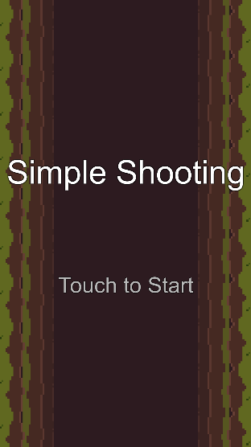
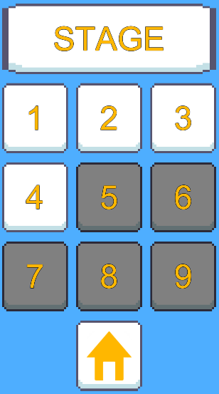
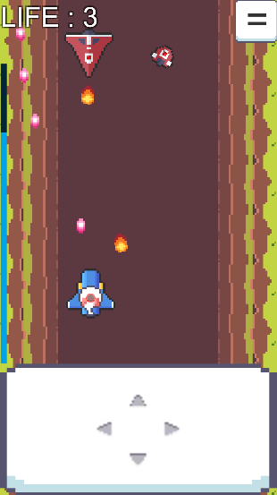
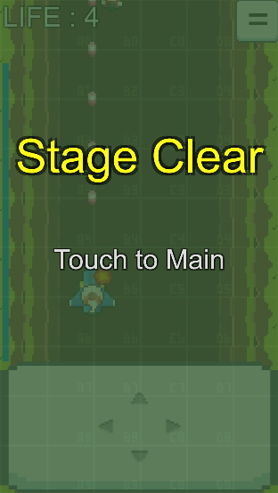
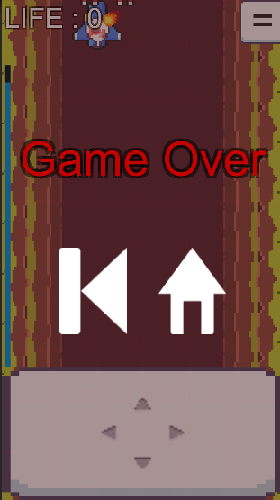

# SimpleShooting

적 비행기를 격추시키는 게임. 슈팅 · 모바일(안드로이드) (Unity 학습 프로젝트).

    

## 플레이

[Releases](../../releases)에서 `SimpleShooting-<버전>-android.apk`를 받아 설치. 처음 설치 시 "출처를 알 수 없는 앱" 허용 필요.

화면 하단의 조작 패드를 터치한 상태로, 조이패드를 조작하듯 터치한 손가락을 움직이면 그에 따라 플레이어 기체가 움직입니다.
플레이어 기체는 자동으로 탄을 발사하며 플레이 화면을 터치하여 폭탄을 사용할 수 있습니다.
정해진 점수에 도달하면 해당 스테이지를 클리어하고 다음 스테이지가 열립니다.

## 제작 노트

슈팅게임을 좋아하여 제작한 게임입니다.
화면을 터치한 상태로 터치한 손가락을 움직여 기체를 조종하는 조작 방식을 구현하는 것 외에는 이전까지 게임을 제작하며 배운 것들의 복습이었습니다.
초기에는 일반적인 슈팅 게임과 같이 적 기체를 고정된 패턴으로 생성하려 하였으나, 이 방식을 어떻게 구현하고 패턴은 어떻게 디자인해야 할 지 알 수 없어 수정하였습니다.
